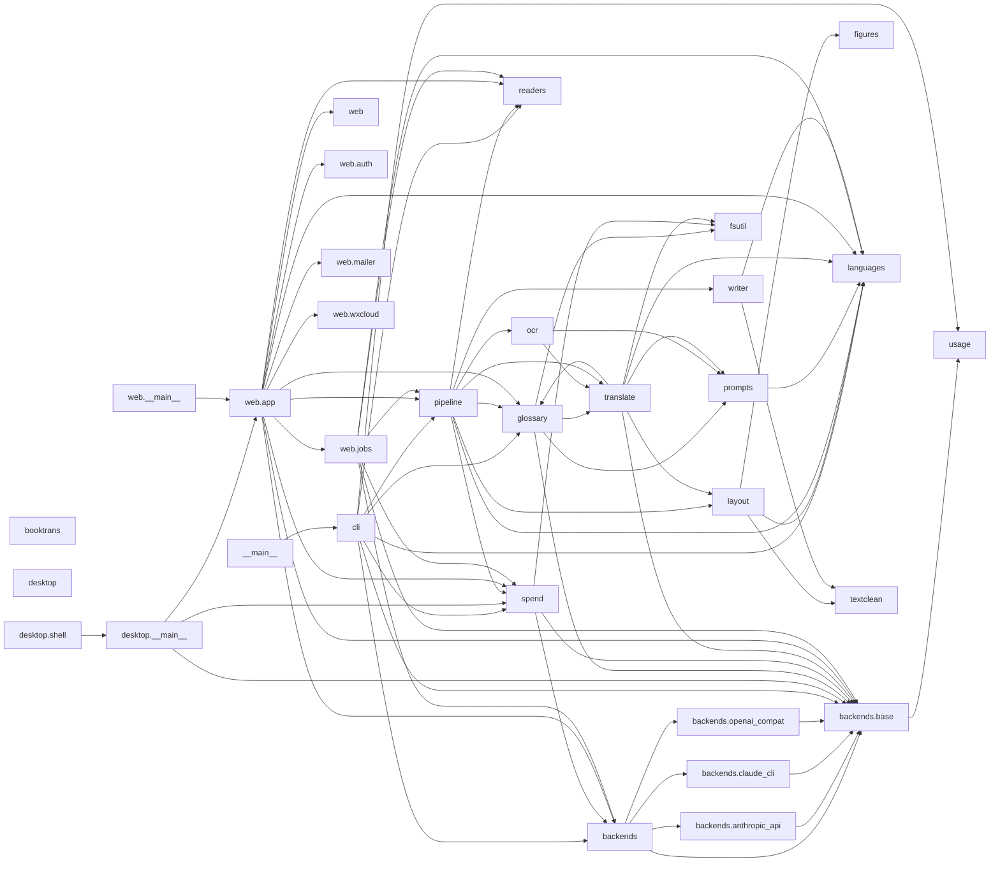

# booktrans 模块依赖图

由 `ast` 静态扫描 `booktrans/` 生成（模块级导入，含函数内的延迟导入）。箭头表示"导入"。
`glossary ↔ translate` 是唯一的循环依赖（`glossary.py:164` 的延迟导入），见 [refactoring-plan.md](refactoring-plan.md) 的 R3。
不含 JS 页面和 `miniprogram/`，也不是函数级调用图。

